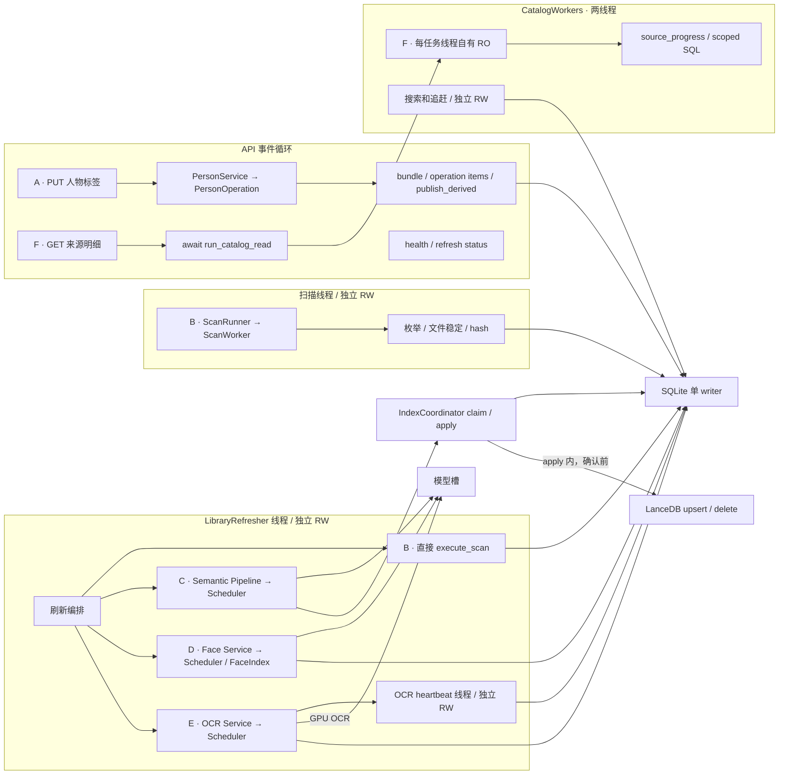
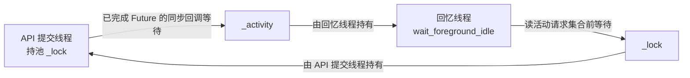

# PhotoSearch 数据库并发与前台卡顿专项排查

2026-11-26 · 只读代码审查、历史核对与诊断设计

审查基线为 [szzeng/aisearch @ c65994af7d8edc7cfcf6cb990a0df0a793e56371](https://github.com/szzeng/aisearch/commit/c65994af7d8edc7cfcf6cb990a0df0a793e56371)。本地与 GitHub `master` 核对时已到 `be6af77193069a8fe90802a67541d987240e3885`，包含指定基线。下文源码路径以 `src/photo_search/` 为根，行号均取指定提交。任务卡所列 `b334bd7` 与指定基线的 `src/photo_search/` 内容一致。报告是本轮唯一新增文件，未执行应用、测试或数据库操作。

## 1. 总体结论

**确认了一个能造成应用级卡顿的缺陷：人物标签 PUT 在 API 事件循环上同步等待 SQLite writer，并在同一线程完成整个改名事务。另发现一个可构成线程级死锁的读池锁序反转。事故尚无两线程实际互等的证据，也无法确定当时的 writer、后台阶段或长时间未恢复的原因。** `PUT /persons/603/label` 的 200 说明该请求最终完成了处理，随后 browse 的 200 与缩略图的 200/304 只记录若干响应。缺少请求到达与完成时间、worker 时间线及线程栈，无法用这些状态码推断单次耗时、操作是否为幂等重放、是否还有其他请求挂起，或全应用何时恢复。

最符合已知路径的解释是，建库连接持有或反复取得 SQLite writer，改名同步等待期间同一事件循环上的健康检查、browse 提交与进度状态读取都可能排队。改名一旦取得锁，还会同步读取人物快照并发布派生待办。图库明细在另一条链上可能占满查询池，进一步延长 browse 等请求的排队时间。持锁竞争、人物规模、Worker 饱和及它们在现场的叠加均须用时间线验证。若故障跨多个已完成响应后仍长期持续，优先查 §4.1 的锁序和长期未退出的原生调用。

| 故障类型 | 证据等级与当前判断 |
| --- | --- |
| 写锁竞争或饥饿 | **已证实（历史合成）** drain 短事务序列令竞争者超时。**待验证（事故）** 是否由同类序列、单条长写或外部进程触发。 |
| 写事务持锁过久 | **已证实（代码范围）** 语义 apply 在锁内执行原生向量写，改名在锁内做随关联规模增长的工作。**待验证** 各路径的实际持续时间与排序。 |
| 多连接写入 | **已证实（代码）** API、扫描、刷新、人脸详情、OCR heartbeat 及搜索追赶有独立 SQLite 连接。Catalog 实例锁无法代表同库 writer 顺序。 |
| 只读 Worker 饱和 | **已证实（结构）** 两条正在执行的明细调用可以占满共享池。**待验证** 现场是否发生、持续多久。 |
| SQL 查询过长 | **已证实（代码）** 明细包含全库计数、范围聚合、按任务/版本关联和可用性探测。**待验证** 实际查询计划、执行和取数耗时。 |
| API 事件循环阻塞 | **已证实（代码）** 人物修改把 BEGIN、业务体、COMMIT 都放在事件循环。**强推断** 此路径可解释该次改名附近多入口卡顿。 |
| 模型、调度器或后台线程等待 | **已证实（代码）** 有模型许可跨 SQLite 写、原生执行和独立心跳。**待验证** 现场的持有者与依赖边。 |
| 重复请求、取消与进度 | **已证实（代码）** 明细缺少在途去重、折叠取消和旧响应保护。**待验证** 浏览器实际请求数及断连传播。 |
| 组合假死或真正死锁 | **强推断** 写等待阻塞事件循环可与查询池排队和显示停滞叠加。**已证实** 读池存在反向取锁条件，详见 §4.1。**待验证** 本次事故是否出现实际等待环。 |

## 2. 历史问题关联

| 历史任务 | 已核对的结论与覆盖 | 对本次事故的意义与覆盖缺口 |
| --- | --- | --- |
| [P4-02U](../tasks/P4-02U.md) · [R2 归因](P4-02U-lock-attribution.md) | 持锁者为后台 `IndexCoordinator.process_batch` 的 `claim/apply`。线程臂 151 次 claim、150 次 apply，写锁占空比 98.96%，最长连续不可用约 32.45 s，单条最长 465.7 ms。进程臂连续窗口约 6.30 s，单条最长 692.6 ms。该夹具排除了 checkpoint 和第三方 writer 对拒绝的归因。 | 证明短事务高占空比也能令前台超时。历史受害者是需写入的搜索投影追赶。改名直接写、当时阶段、当前批次开销都需重新测量。 |
| [P4-02V](../tasks/P4-02V.md) · [修复](P4-02V-contention-fix.md) · [独立主审](P4-02V-dsh-affected-surface-review.md) | 搜索投影 `catch_up` 在连接上临时收窄 busy timeout 到 100 ms，BEGIN BUSY 后保留队列并返回 `LAGGING`，退出时恢复配置。原卡 PASS 限于合法搜索争用拒绝的闭环。 | 复用现有降级。人物改名、来源登记/改名/删除、收藏等直接写不经过该入口。当前 BEGIN 重试叠加已改变有效等待，见第 3 节。 |
| [P4-LOCK A/B/C/D](../tasks/P4-LOCK-CONTENTION-RECOVERY-A.md) · [合订报告](P4-LOCK-CONTENTION-RECOVERY-A.md) | A 仅重试 BEGIN 前 SQLITE_BUSY，两次退避，记录等待方身份。B 移除刷新全周期模型槽，扫描 BEGIN 争用复用持久 RETRY_WAIT，来源删除在事务内核验 lease。C 加入人脸等待、待办保留及扫描累计 30 s 最多三次续跑。D 补等待中异步取消证据并复核人脸槽范围，基线历史含 `f9d3e40`。 | BUSY 和续跑恢复的是单条调用或任务。没有前台写优先、成功事务分段观测或事件循环隔离。ScanRunner 的退避续跑和 LibraryRefresher 的直调扫描分别验证。D 证据覆盖等待阶段，活动推理和索引发布另测。 |
| [P4-BUILD-STABILITY-A](../tasks/P4-BUILD-STABILITY-A.md) · [报告](P4-BUILD-STABILITY-A.md) | 合成环境中验证了长锁后的扫描恢复及部分 Worker/租约关闭。 | 是恢复机制的历史证据，不能作为当前人物写响应或公平性的验收。 |
| [P4-BUILD-STABILITY-A2](../tasks/P4-BUILD-STABILITY-A2.md) · [报告](P4-BUILD-STABILITY-A2.md) | 真实产品编排已引入模型槽顺序、GPU OCR 单图安全边界、CPU OCR 独立路径、线程自有连接与关闭失败保留、进度心跳和应用 owner 时钟恢复。代码验收有历史定向证据，整套回归包含 24 项历史失败、52 skipped。目标 GPU/HDD 与真实模型待验。 | 模型侧前台标记供**语义查询**使用。改名不注册该标记，且不请求 GPU。CPU OCR 仍是同库 writer。A2 的关闭机制应复用，不能据此认为新的写 Worker 或浏览器断连已经覆盖。 |
| [图库明细 A](../tasks/P4-SOURCE-DETAIL-STABILITY.md) · [前台写 B](../tasks/P4-FOREGROUND-WRITE-FAIRNESS-A.md) | 两包在[父卡](../tasks/P4-CATALOG-CONCURRENCY-STABILITY.md)中分别规划，基线[状态页](../development-status.md)记载当前启动门槛。 | 两条链共享 API 与机器资源，故障机制分别成立。联合测量应保留两条独立排队时间线。 |

## 3. 根因证据表

等级约定：**已证实**表示指定提交上可定位的调用和事务行为，或注明夹具的历史测量。**强推断**表示可从行为推导的因果机制，仍欠现场时序。**待验证**表示需复现、测量或现场证据。

| 优先级 | 判断、调用与代码位置 | 证据等级 |
| --- | --- | --- |
| P0 | `api/routes.py:324–333,3152–3165` 的 `put_person_label → persons_of → PersonService.rename` 没有 await/线程迁移，使用 `api/context.py:232–247` 的应用 Catalog。同步等待和业务体足以阻止同 loop 上的 `health` 被调度，`browse_persons`（`routes.py:2772–2795`）本来可 await 查询池，却可能连入队都等不到。 | 已证实路径。对事故是强推断。 |
| P0 | `catalog/db.py:20–21,130–209` 的 `Catalog.write` 先拿实例 RLock，再 BEGIN IMMEDIATE。5 s 来自 `catalog/sqlite_io.py:12,58–81`。三次尝试加 50/100 ms 退避，在各次用满默认 SQLite BUSY 等待的形状下约 15.15 s 才结束 BEGIN 路径。之后的业务体、COMMIT 和外围 drain 重试另计。错误详情记录等待者，成功路径缺少通用分段诊断。 | 已证实配置与路径。15.15 s 为配置推导，非实测上界。 |
| P0 | `persons/service.py:36–47,90–110` → `persons/operations.py:729–814` 在持锁后验证/归一化、核对请求摘要与 replay、解析 canonical、查 revision/重名、记录操作。该 `/label` 禁止隐式合并，`/name` 可走同名 merge。普通 rename 在 `operations.py:455–470` 更新前后各读一次 `bundle.read_bundle`。`persons/bundle.py:66–101,110–134` 查询人物、别名、全部 person links，按既有字段和顺序构造与比较快照。每个操作项保存前后 JSON（`operations.py:669–711`）。同名无变化仍记已有日志语义，但跳过派生。 | 已证实工作量随关联数增长。最大规模和实际耗时待验证。 |
| P0 | `operations.py:522–611` 的 `publish_derived` 将前后 face IDs 去重，分块查询资产；每资产上推文本投影队列，按 face 查当前候选 entry 并 enqueue repair；`places/revision.py:56–100,119–140` → `indexing/store.py:1458–1509,1512–1609` 还为已确认的资产向量分配同 revision 的刷新事件、重排相关 entry 状态。它们是 SQLite 队列/状态操作，真正 Lance 写由消费者执行。 | 已证实。按脸和资产重复查询、排序和快照构造是可测优化点，派生范围本身有契约依据。 |
| P0 | `indexing/maintenance.py:158–193` → `indexing/store.py:936–950,1014–1039,1101–1195` 连续 claim / apply；apply 事务内做 authority 重读、记录构造、Lance upsert/delete、确认和 generation 更新。记录构造 `_record`（`store.py:1243–1272`）还读取 embedding artifact 内容。Lance 返回、SQLite 确认之间的窗口由既有重放规则覆盖。 | 已证实 I/O 位于持锁区、连续批次无人物写让步。事故 holder 与最长事务排序待验证。 |
| P0 | `ingestion/scanner.py:562–606` → `catalog/store.py:589–630` 的最终 reconcile 在事务里 UPDATE + RETURNING 全部变成 MISSING 的位置，样本上限仅截断返回给后续调用的 asset IDs。事务还包含 scan 成功及保留证据。目录遍历、稳定等待、hash 在其他事务之外（`scanner.py:779–832,987–1091`）。多连接可反复取得 writer，但不能用“扫描每文件短写”覆盖最终事务。 | 已证实范围。大缺失比例或慢盘下的时长待验证。 |
| P0 | `api/catalog_reads.py:20,77–112,234–269` 只有两个执行线程，executor submit 未设应用层队列容量。明细、完整来源列表、browse、其他查询以及 RW 搜索/投影共享它。两个运行中的明细可占尽线程，第三条仅排队。独立 `health` 和 `/library/refresh` 的状态读取（`routes.py:331–333,1041–1043`）可作为分辨探针。 | 已证实饱和条件。实际占用、后续 queue time 待验证。 |
| P0 | `_CatalogWorkers.submit()` 在 `_lock` 内注册 Future 回调，已完成 Future 可在提交线程同步执行 `_finished()`，形成 `_lock` → `_activity`。同一池 `wait_foreground_idle()` 则按 `_activity` → `_lock` 取锁。回忆线程是后者的产品调用者。具体代码与交错见 §4.1。 | 已证实反向边和成立条件。运行时复现及事故归属待验证。 |
| P0 | `web/app.js:460–488,942–1020,1114–1135` 的 `loadSources` 清空全部缓存。重建已展开卡片时显式加载，toggle 也能调用加载。缓存只在响应后填充，缺少同 source 的 in-flight 合并、折叠时 abort、响应代际验证。刷新状态轮询收到响应后才安排下一轮，错误分支清掉计时器。刷新完成还会 `loadSources`（`1680–1704`）。因此长请求或轮询失败可表现为进度滞后，须与后台 durable 进展对照。 | 已证实重复及 stale response 的路径。具体浏览器 toggle 调度、重复数待验证。 |
| P1 | `routes.py:863–895,926–944` → `ingestion/service.py:179–183` → `catalog/store.py:845–899`：每条明细先读 binding/可用性，再查来源、全局 `assets_total`、来源位置聚合及 scan/jobs；`refresh/progress.py:124–177,180–230,284–406,452–561` 再计算扫描、built marker、语义、范围分母与可用增强阶段，空范围仍走多条零结果 SQL。jobs 关联使用 CAST，OCR 有相关子查询。 | 已证实有空域可省工作及独立探测。具体慢 SQL、索引选择、全局 COUNT 成本为待验证。 |
| P1 | `web/app.js:257–282,1003–1019,1114–1135` 的通用 fetch 支持 signal，但明细调用未传。服务端 `catalog_reads.py:62–74,131–185,234–242` 在 coroutine 收到 CancelledError 后才标记、取消 Future、interrupt 活动 SQL。明细路由/安全 middleware 无 disconnect 监听。真正释放要观察 SQL 返回、连接关闭与 Future 完成。 | 已证实实现范围。浏览器 abort → ASGI disconnect → handler cancel → 容量释放待验证。[SQLite interrupt](https://www.sqlite.org/c3ref/interrupt.html) · [ASGI HTTP disconnect](https://asgi.readthedocs.io/en/latest/specs/www.html#disconnect-receive-event) |
| P1 | `search/documents.py:291–301,327–344` 收窄的是**每次 SQLite busy timeout**，当前仍调用通用 BEGIN 重试。纯 BUSY 且三次各耗尽 100 ms 的配置推导为约 450 ms（300 ms + 150 ms），每轮 catch_up 还可能处理多个成功批次。 | 已证实静态叠加。实际耗时、既有回归是否要求整批 100 ms 待 B0 核验。A/B 复用现行入口与 LAGGING，不在本轮改预算。 |
| P1 | `scheduler/engine.py:413–496,685–728` 先 prepare，再在 BEGIN 内发布文件、写结果和 durable 队列。 `artifacts/store.py:153–184,211–222,224–294` 的准备哈希/临时文件写在事务外，最终文件发布（含 `os.replace`）在事务内。人脸关联 `face/index.py:986–1100` 在事务中重读人工控制并做候选判断/更新。 | 已证实另有锁内 I/O 与 Python 工作。相对排序待测。 |
| P1 | 语义/人脸/GPU OCR 出现 Slot → SQLite，候选出现 Slot → Gate → SQLite。未在事故改名链找到 SQLite → Slot/Gate 的反向边。后台 GPU 让步检查的是模型前台标记；模型前台线程可能在 `runtime/background_slot.py:79–120,143–175` 反复等 slot 或 marker，缺少总等待期限与取消参数。搜索 Worker 长等可和第二个慢请求一起占池。 | 已证实前向持有和辅助等待。原生内部、其它调用路径的反边及事故循环待验证。 |
| P1 | `api/context.py:574–777` 保留未结束 Worker 和数据根租约。查询池 `catalog_reads.py:187–196` 的 `shutdown(wait=True)` 和 OCR `lease_heartbeat.py:55–64` 的 join 等真正退出。库查询离开 SQLite 进入 Python、模型或 I/O 时，interrupt 可能无法即时收尾。 | 已证实关闭可延长、未结束资源被保留。永久卡住、遗留 lease/连接和故障恢复结果待验证。 |
| P1 | `api/catalog_reads.py:166–185,107–111` 的 query finally 单次关闭连接，异常时仍清 request.connection，Future 完成回调移除跟踪。`ocr/lease_heartbeat.py:55–64,99–101` 则在线程内单次关连接，join 未接收关闭异常。二者与后台 runner 的同线程可重试关闭不同。 | 已证实收尾差异。注入 close 抛错时是否遗留资源或提前释放数据根 lease 待验证。 |

最先量在途 holder 的真实区间。优先比较语义 apply、扫描最终 reconcile、大人物 rename/merge/undo、增强入队页、人脸聚类/发布、Scheduler 提交和 FTS 投影批。选取短事务序列、单事务长尾、两者并存三类形状。外部进程持锁只有该进程自报或独立证据时才归属。SQLite 的连接间单写者规则及 BEGIN IMMEDIATE 行为见 [SQLite 事务文档](https://www.sqlite.org/lang_transaction.html#read_transactions_versus_write_transactions)。

改名的首个安全减负候选是把无 DB 依赖的 payload 规范化与摘要构造移到事务外，在不改错误顺序和幂等摘要的前提下复用结果。随后用合成分段数据决定是否合并按脸/按资产的 lookup、避免普通 rename 的重复快照读取。只有证明快照中别名、关联、排序、触发器影响与 before/after JSON 完全等价，才考虑复用同一事务内未变化的部分。replay、revision 校验、人工状态、undo 数据和派生发布必须保留在权威提交边界内。

## 4. 并发调用图

图中 RW 与 RO 代表各自线程拥有的连接。所有 RW Catalog.write 都走实例 RLock → BEGIN IMMEDIATE → 事务体 → COMMIT/ROLLBACK。SQLite writer 由同一个库文件仲裁。应用的数据根 lease 用于进程所有权和关闭，模型槽在 Windows 上还包含协作进程的命名 mutex。两者的作用域均不同于实例 RLock。



| 路径 | 线程、连接和 Python 锁 | 事务边界、等待、取消与恢复 |
| --- | --- | --- |
| **A 人物修改** | API 事件循环上的应用 RW Catalog，PersonService 随请求构造。以实例 RLock 包住 BEGIN/COMMIT，无模型槽或 Gate。 | `api/routes.py:324–326,3156–3165` → `persons/service.py:90–110` → `persons/operations.py:729–814` → `publish_derived` → 提交后才从 handler 返回。BEGIN 有通用 BUSY 重试，handler 同步段无主动取消。恢复依赖原请求 request_id 重放和 revision 判定，已提交操作可通过既有 undo 补偿。 |
| **B 扫描** | `api/runner.py:82–91,184–209,321–333` 的 ScanRunner 持队列 Condition，取任务后释放，再在线程内构造独立 service/RW。LibraryRefresher 另有线程和 RW，直接调用 `refresh/pipeline.py:427–465`，不经过 ScanRunner 的循环。两者正常扫描均无模型锁。 | `ingestion/scanner.py:450–461,779–832,987–1091,562–606` 的启动/领取、位置观察与 heartbeat、hash 后绑定、最终 reconcile 为多次事务。`catalog/store.py:291,503` 的观察/绑定保留位置及内容身份。文件 I/O 有稳定窗口及作业检查点，取消在枚举/哈希安全点处理，普通 BEGIN 不查 stop。BEGIN BUSY 可尝试 `_requeue`（`ingestion/scanner.py:1234–1277`）。ScanRunner 累计额外条件等待预算 30 s，最多三次自动续跑，和普通扫描耗时分开。写锁使 RETRY_WAIT 本身无法提交时，按有效 lease/过期接管恢复。刷新直调会记录阶段失败并继续编排，不能假定同一刷新内部拥有 Runner 的续跑。 |
| **C 语义索引** | `api/refresher.py:131–138,206–245` 创建 refresher 线程与自有 RW，锁保护队列/状态。`refresh/pipeline.py:544–835,841–1233` 分类、模型阶段串行。候选 build 有自己的线程/RW，顺序为 Slot → Gate exclusive（`models/embedding/candidate_task.py:319–370`），常规刷新无需候选独占 Gate。 | `indexing/semantic.py:365–423,774–891` → durable 入队 → Scheduler claim → 事务外 encode → submit → drain。claim 与 apply 分事务，apply 在同一 SQLite 写事务内重验、写 Lance、确认（`indexing/store.py:1014–1195`）。模型槽等待可取消且 60 s，模型段占槽范围仍包含 build/drain/profile 写。编码循环听模型前台标记，`indexing/semantic.py:877–891` 即使因该标记退出仍进 drain。刷新取消主要在轮次间，apply 及其原生 I/O 无独立可取消期限。drain 有既有有界 BUSY 重试、IN_FLIGHT 重放和缺失向量重执行路径。 |
| **D 人脸识别** | 常规人脸在 refresher 自有 RW 上运行，由 `refresh/pipeline.py:2065–2122` 外层持 Slot，`face/service.py:52–76,428–519,640–696` 可重入。同槽还服务 `api/face_detail_runner.py:45–74,143–183,217–294` 的独立线程与 RW。无候选 Gate 依赖。 | detect 入队、Scheduler claim、事务外推理、submit、FaceIndex claim/publish/confirm、关联写。SQLite 候选发布是 `face/index.py:163–275,309–356` 的既有独立事务链。通常 Slot 先于 SQLite，常规刷新外层覆盖索引与关联。Slot 等待最多 60 s 并查取消，忙/取消按既有 source/delta 规则留待办。已进入 `_face_stage` 后，detect 调用没有继续传刷新 cancel，且 outbox/关联 drain 无逐项取消。FaceDetail 批路径有自己的暂停/取消边界，单图与批需要分别验收。 |
| **E OCR** | `refresh/pipeline.py:2212–2312` → `ocr/service.py:715–908`，默认刷新线程 RW，CPU 不占 Slot，GPU 取已有 Slot 后做资格、claim、推理、submit 与 fallback。`OcrLeaseHeartbeat._loop`（`ocr/lease_heartbeat.py:66–101`）使用独立线程 RW，Condition 管活动身份和停止标志。 | `scheduler/engine.py:156–294,362–379,413–496,685–728` claim/heartbeat/submit 各有明确事务，图像与推理在事务外，submit 重验 lease token、processor 和 input revision。GPU 一批最多 8，单任务间检查模型前台活动/取消。slot 忙且没有 CPU 进展的等待分支查 60 s 预算，取得槽、执行或重新进入等待分别计时。job lease expiry/重验与 fallback 保留恢复，取消不打断活动单图。heartbeat 的 join 等其 DB 操作退出。 |
| **F 图库明细** | async handler await 查询池，每个明细创建真实 RO 连接，执行后由创建线程关闭。池 per app owner Catalog。池锁保护请求集合，Condition 跟踪活动，request lock 防止 interrupt/close 并发。 | `api/routes.py:926–944` → `api/catalog_reads.py:131–185,234–248` → source_progress。基线单明细没有外层读快照，读语句在 autocommit 各自取快照。完整列表 `api/queries.py:718–735` 有 BEGIN DEFERRED 读快照。明细无业务写事务与模型槽，仍有连接打开、资源探测、SQL 和构造结果。没有端到端排队/执行超时。任务取消可取消排队项或中断活动 SQL，客户端断连传播待验。明细无 durable job，失败后重新读取。 |

**其他增强阶段。** `refresh/pipeline.py:1476–1710` 按阶段/来源分页，`_thumbnail_stage`（1771–1841）调媒体生成。缩略图/预览解码及文件缓存是独立 I/O 观测项，另计 CR2 候选恢复写（`refresh/cr2_recovery.py:194–230`）。`_taken_time_stage`（1913–1930）使用 `taken_time/service.py:133–170,288–335` 的入队及 Scheduler。`_gps_stage`、`_resolver_stage`（1933–1988）配纯 Python Scheduler，`_enqueue_assets`（2365–2391）在同一事务逐项入队，`_drain`（2340–2348）交替领取和提交。GIS/EXIF 执行与结果提交分别计时。投影在语义前及后续阶段调用 `_catch_up_projection`（501–540），每轮含独立 FTS 写批，遇 BUSY 零进展停轮保留队列。`_mark_scopes_built`（1234–1256）和 `resolve_face_profile`（129–145）也进入 writer 清单。

**等候方向。** 当前 A 的主要等待链为 API loop → SQLite writer → 后台事务体或外部 writer。常规推理链可从模型槽延伸到 SQLite。候选路径为模型槽 → Gate → adapter/Worker 与数据库。搜索按 `api/context.py:462–549` 先释放 adapter lock 再等待 slot，拿许可后重查。`runtime/model_resource_gate.py:44–100,115–125` 的 query 遇候选保留直接拒绝，exclusive 等已有 readers 时释放 Condition。持槽路径使用 foreground_model_waiting 非阻塞探查语义前台标记。改名不等待模型或浏览器请求。两条已证实的等待边可放大延迟，一是持槽后等 BEGIN，二是前台查询入池后无总时限地等槽。改名事务链本身未见后台依赖被阻塞的改名 handler 的反边。读池与回忆线程有独立的锁逆序，见下节。原生库、Windows mutex、关闭期间 join 等应在超时采样中补全。

**关闭链。** `app.py:65–95` → ApiContext.close 先停后台并保留失败引用 → owner 线程关闭 service/Catalog 和查询池 → lease 释放。ScanRunner/Refresher 默认各 join 5 s，未结束转 A2 延后路径，Catalog pool close 和 OCR heartbeat join 等待实际退出。关闭线程等待 owner loop 回调（`api/context.py:681–731`），loop 已不可用时保留 lease。压力复现区分暂时保留、进程退出前一直未释放、进程已结束后的持久 job lease。时钟回拨恢复仅针对可识别的历史应用 owner，保留无此前缀的 CLI/旧 lease 边界。

### 4.1 查询池存在可闭合的反向取锁

**已证实的静态顺序。** `api/catalog_reads.py:90–111` 的 `_CatalogWorkers.submit` 持有池的 `_lock`（RLock），提交任务、登记请求后调用 `future.add_done_callback(self._finished)`。若 worker 已完成，CPython 在提交线程立即调用回调。`_finished` 重入 `_lock` 并移除请求，离开内层 with 时外层 submit 仍持锁。它接着试取 `_activity` Condition。`api/memories.py:486–501,535–547` 的回忆线程会调用同一个 owner 池的 `wait_foreground_idle`（`api/catalog_reads.py:117–125,220–224`），持 `_activity` 进入 `_lock`。250 ms 是取得内层锁之后的 Condition wait，无法解除卡在内层取锁的情况。 [CPython 3.12.10 Future 回调实现](https://github.com/python/cpython/blob/v3.12.10/Lib/concurrent/futures/_base.py#L376-L393)



满足「同一 owner 的回忆线程已持 Condition」「Future 在回调注册前已经完成」及图中的取锁时序时，两个等待都没有退出条件，可形成 Python 线程死锁。此路径不要求 SQLite writer 被占用。API 卡在提交任何快读时，连 health 都无法运行。现有事故日志没有回忆任务或这两条栈，不能把它归因到该环。查询池正常的两线程饱和也不构成这个环。

## 5. 修复建议

### 直接复用

- 复用 `BEGIN_BUSY_RETRIES`、busy timeout、BEGIN/COMMIT 错误区分、搜索追赶 `LAGGING` 和现有预算配置、扫描 RETRY_WAIT、job lease/heartbeat 与时钟、模型槽/Gate、CatalogWorkers 线程自有连接与生命周期、语义及人脸 outbox 重放。B0 比较新旧组合的实际等待时长，保留现有错误分类。
- 复用 `api/catalog_reads.py:90–129,199–231` 跟踪 queued/running、Condition 通知和关闭的做法。`api/memories.py:480–548` 使用该活动状态给低优先级读取让路。它只认 owner 池请求，普通读、查询投影和搜索都计入活动，人物直接写与其他 Catalog 实例并不登记。模型前台计数用于 GPU/语义。两者可复用设计方式。
- 复用 `search/perf_diagnostics.py:49–60` 及 `api/catalog_reads.py:136–184` 的轻量指标和命名。trace callback 可计数，SQL 实际耗时须包住 execute 和取数。Drain 的 `_timed_write`（`indexing/store.py:746–791`）提供历史可比口径，另加独立 COMMIT 与重试指标。

### 证据支持的新增能力

- **A 前端与读容量。** 按 source_id 单飞、当前容器代际检查、定向失效、同一视图限制明细并发，呈现排队、失败及重试状态。先用单明细并发测其他消费者。多个标签页或直接 API 仍可同时占池，若需保障此场景，先复现后决定是否需要作用域明确的服务端 admission。浏览器 abort 与 ASGI task cancel 之间如有断点，优先针对该路由接通断连观察，复用 `_Request.cancel()`。
- **A 共享池锁序。** 优先复现 §4.1。保持请求在锁内登记、把可能同步运行的 Future 回调注册放到临界区外，是最小候选。另一种候选是让 Condition 使用同一个池状态锁并消除嵌套顺序。任选一种前须验收 Future 已完成、排队取消、close 与注册竞态、请求仅清一次、回忆唤醒不丢和 lease 释放。沿用现有池及关闭契约，按共享生命周期变更评审。
- **A SQL。** 空 scope 优化先建立同一可解释的读快照，或用单条等价查询判断，避免 K 为零与后台绑定提交之间的混合代际。保留全库 COUNT DTO、历史关联位置与当前 PRESENT 绑定两种口径、built marker、`UNBUILT/NO_IMAGES/UNAVAILABLE`、OCR `runtime_available` 和真实零值。若改变明细的快照边界，测读事务时间、取消回收和 WAL checkpoint 进展。凭实际计划与计时挑选改写。
- **B1 人物写隔离。** 独立有界 Worker 线程内以 `connect_rw(..., create=False)` 或等价方式打开既有库并构造 Catalog，继承 owner clock/lease 配置与身份，同线程关闭。可观测提交、拒绝、排队取消、开始和完成。队满映射至明确可重试响应。活动事务安全收尾，同 request_id 重发沿用 replay。先以外部 writer 闸门证明活动改名等待时 health 仍可响应，并量测小人物和大人物的业务体与提交。B1 单独验证事件循环隔离，B2 才评价 writer 公平。
- **B2/B3 后台批次。** 以规范化的同一库文件/数据根身份取得进程内协调状态，由 app context 传给实际后台入口。事务前发布可追踪的批次许可，前台入队前登记 intent，队满、取消、异常、完成路径成对释放。Condition lock 只保护状态变更。显式定义同一时刻允许多少个已 admission 的后台 BEGIN、哪些控制写可推进、连续前台到达时后台获得机会的上限、外部 BUSY 如何退出和归还许可。“先查前台忙否再 BEGIN”存在竞态。
- **B2/B3 锁序。** 在拿模型槽前完成可能阻塞的普通后台 admission，或在完整安全批次后释放模型所有权并延后领取。各阶段明确哪些现有所有权必须成组保留。活动 job 的结果提交、lease heartbeat、扫描状态转移、outbox claim 后的闭合/重放和关闭清理须有可测边界。已领取的 OCR、人脸和语义任务不在前台等待中长时间悬置。若候选 Gate 或模型所有权无法在安全点释放，先证明其影响并确定独立策略。

### 保留的契约

人物 authority、operation bundle、revision、undo、request_id 与同 revision 派生发布按原单事务语义处理。锁内减负先验证结果等价和失败回滚。语义 outbox 保留 authority 重读、最新投影版本优先、Lance 写入与 SQLite 确认的既有顺序及失败重放，Face 候选按其 SQLite 协议。维持 WAL、全局 busy_timeout、schema、索引、任务标识、人工状态和 DTO。协调不新增全局互斥锁，也不跨线程传递 SQLite connection。 [人物操作 ADR](../decisions/ADR-0006-person-naming-merge-operation-contract.md) · [人工纠正 ADR](../decisions/ADR-0007-face-correction-lock-exclusion-contract.md) · [人物拆分 ADR](../decisions/ADR-0008-person-split-operation-contract.md)

## 6. A/B 工作包影响

| 工作包 | 已覆盖 | 实施前需补齐 |
| --- | --- | --- |
| A 图库明细 | 缓存定向失效、单飞、上限、空 scope、SQL 计划检查、取消和浏览器闭环。 | 新增 §4.1 反序用例并定向处理共享 pool，避免复用时扩大环路。确定跨标签页/直接调用的保留容量承诺。分开测浏览器取消、executor 取消、SQL 停止及第三读取实际开始。关闭与重开用代际保护缓存。按 build 完成、scan/内容绑定、删除/重新登记、运行中增量确定失效。单明细和完整列表共用进度函数，二者都做等价回归。量测 `POST /sources` 同步登记及返回完整 counts（`api/routes.py:917–923`、`ingestion/service.py:193–232`）。第三来源登记实验拆开其响应时长及摘要刷新触发的明细数量。 |
| B 人物写 | B0 观测、专用 Worker、有界队列、事务前 admission 和双向公平、控制写例外、关闭和联合验收。 | 完成 route 写矩阵。除 label/name/merge/split/undo，`api/routes.py:2752–2770,2901–2909,2927–2936,3288–3348` 涵盖 mapping decision、visibility、cover、face assignment、create/批量与 regroup。另审视 `2683–2700,2808–2875,2994–3055,3069–3149` 的操作保留、人物合集/收件箱、rematch 和 face detail 任务控制。按人控操作与维护分类，登记纳入或单列的理由、实际 service 及 request_id 覆盖。来源、收藏、地点和相册同步写另记覆盖缺口。 |
| B 后台接入 | 已列扫描、绑定、语义、FTS、元数据、人脸与 OCR。 | 补 `IndexCoordinator.process_next/process_batch`、外层 maintenance 重试、candidate、FaceIndexCoordinator 独立发布、OCR heartbeat/capability/fallback、build marker 和最终 scan reconcile 的具体 admission 归属。分清刷新直调扫描、ScanRunner 与独立进程。为控制写和普通后台分别验证有界推进。标注绕过 app 数据根 lease 的 CLI 与第三方 writer。 |
| 联合 | 同一合成库并发使用 A/B。 | 固定独立对照与叠加。只堵 Worker、只堵 SQLite BEGIN、只等模型槽、同时发生。分别用 health、刷新状态和 browse 判断 loop、编排状态及共享池。持久任务收敛与操作结果等价均需验证。 |

A 的读 admission 与 B 的写意图各自计量。两包共用关联 ID、时钟、诊断字段、隔离夹具和联合验收。若 A 触及共享 Worker 取消/关闭，或 B 修改共享竞争、事务、恢复边界，按 V3.1 §2.4 做独立 DS-H 完整受影响面审查。范围内 API/浏览器验收仍为门禁，高风险 ADR 未决才加 Sol 聚焦终审。父卡仍规定先完成随机浏览剩余验收及孤儿清理浏览器验收，然后阶段 0 → A → B → 联合回归。

## 7. 最小复现与诊断方案

### 7.1 夹具与执行规则

后续阶段 0 使用独立临时 data root 和单独的合成照片目录，2～3 个来源，总计约 50～100 张人工生成素材。两个来源初始未建立位置，再用相同 ID 逐步构造待绑定、已绑定、MISSING、跨来源重复绑定及 built 但无语义目标。为人物准备零链接、少量链接及高关联扇出三档，区分不同 face 共用资产与每脸独立资产。用既有 fixture 生成合法历史 revision、人工锁/排除、已确认的语义和人脸候选，以及新旧 OCR job。背景 N 与范围 K 独立变化，只做局部计划和增长趋势对照。模型使用确定性假 encoder、detector 和 OCR engine。Lance 测试先在既有适配器边界装闸门，另用已安装依赖和合成向量调用真实本地 Lance 验证恢复，禁止拉取资源。

启动真实 API 路径之前，测试线程与应用事件循环使用独立控制器。每个 holder/worker 闸门设置“已进入”“允许继续”“已退出”。使用 Event 或 Barrier 排序，发布 marker 后再提交下一动作。外部控制器发起探针、记录到达时序并确保 finally 释放闸门。超时仅作为 watchdog 或显式验证既有预算，可用假时间/等待替身控制 lease 与 retry；不用随机 sleep 碰撞。注入点以进程本地测试包装或现有 failpoint 接入，保持生产入口、连接归属和实际事务边界。无需修改用户图库或安装目录。

### 7.2 测量与分类

| 层次 | 记录字段与采样点 | 用途 |
| --- | --- | --- |
| SQLite writer | 单调时钟下记录调用到达、实例 RLock acquired、每次 BEGIN 的 enter/exit/SQLite 代码、retry 退避、首个 BEGIN 成功、业务体结束、COMMIT/ROLLBACK enter/exit。记录 role、stage、operation、连接临时 ID、PID/线程名/native TID、同库匿名标识、job/事务关联 ID、结果及 attempt。 | 算成功和失败的 BEGIN wait、纯事务体、COMMIT 与持锁总时长（BEGIN 成功至 COMMIT/ROLLBACK 结束）。同库时间线绘出占空比、间隙、等待者是否在多次提交间持续饥饿。已有 BUSY 详情只是 waiter。 |
| 读池与 SQL | HTTP submit、worker start、连接 open、各阶段 SQL 开始/取数结束、响应构建、cancel observed、interrupt、连接 close、future finished。记录排队深度/活动数和查询标签，不记展开后的 SQL。对 `semantic_breakdown`、普通增强、OCR 和 `catalog_counts` 记录 EXPLAIN QUERY PLAN 与 N/K/历史任务形状。 | 分出 Worker 排队、连接/文件探测、SQL/取数、Python 装配。空范围 SQL 篇数和计划只是诊断，响应与真正回收单独验收。 |
| API / 浏览器 | 从另一个线程或子进程记录 client send/receive。loop heartbeat 用预定 deadline 与实际执行的差值。服务端记录 route 到达、开始、响应。并行 probe `/health`、`/sources/summary`、`/library/refresh`、`/persons/browse`。记录请求发出、fold/abort、disconnect、重新展开、消费响应与进度刷新。 | health 无查询池/DB，loop stall 和读取轮询互相校验。health 正常但 browse 排队可指向池，确认还需 queue 证据。UI 停滞但服务端进度活跃则查轮询/状态映射。 |
| 模型与恢复 | 记录 slot/Gate/adapter 的 wait/acquire/release、原生调用 enter/exit，Scheduler claim/heartbeat/submit、outbox 状态、lease ownership、worker shutdown。超 watchdog 采连续线程栈及活动事务/模型/队列快照，仍有疑义时对合成进程采原生等待。 | 给出等待边、持有者与实际退出原因。仅同进程已登记的 holder 或受控外部进程能归属，其他填 unknown。比较 pending/running/retry/confirmed、最终 revision 与队列收敛。 |

跨进程事件使用配对锚点校准时间线并保留各进程单调时间。诊断上限按[性能指南](../performance.md)和现有任务预算，保留计数及截断标识。落盘去掉人物名称、原图路径、状态授权凭证和绑定参数，JUnit/JSON/浏览器证据放项目忽略目录。同步探针不能由受测 loop 自己发出，否则漏掉停顿。

### 7.3 九个并发场景与锁序反例

| 场景 | 受控交错和观察点 |
| --- | --- |
| 1 · 扫描 + 改名 | 在观察位置或绑定的 BEGIN 成功后卡住，提交真实 label PUT，再独立探测 health。分别释放后续一批、连续文件事务，并将闸门移到最终 reconcile。对照将闸门移到 hash 中而不持 writer。分别跑 ScanRunner 和刷新直调。核对 scan_id/job identity、位置绑定、缺失协调与进度。 |
| 2 · 语义 + 改名 | 用 fake encoder 先控制事务外 encode，再用 apply 内 Lance adapter 闸门覆盖长事务，独立控制 claim/apply 完整批之间的短事务序列。先量无公平性基线的连续间隙，再测 intent 到达后后续 admission。用既有 after_lance failpoint 比较重放后的向量数量、generation 与 SQLite 确认。 |
| 3 · 人脸 + 改名 | 两分支分别暂停在持 Slot 的 detector 和 Scheduler result/FaceIndex 事务 BEGIN 后。另让已有线程持槽，触发超时和等槽取消，再释放验证同 revision 待办续做。常规与 FaceDetailRunner 各测，人工修正/排除与 revision 不被迟到结果覆盖。 |
| 4 · OCR + 改名 | fake CPU/GPU 设备各走真实 claim/submit。分别卡在 inference、提交、独立 heartbeat 写，验证 CPU/Slot 分离与 GPU 延长持有链路。让假时间逼近 lease expiry，核验 heartbeat 和旧 owner 提交判定，断开/重启后同任务按现有规则收敛。 |
| 5 · 两个未建库来源同开 | 精确等待两个来源明细进入各自 worker，提交第三条真实池查询和独立 health。只释放一个明细，验证第三条何时开始。浏览器里覆盖重建、同时展开、折叠重开、登记第三源；记录每 source 请求数和全库 COUNT/空 scope 阶段时长。 |
| 6 · 明细 + 建库 + 改名 | 两条 RO 明细卡在真实 SQL 前后，后台先持 writer，改名进入 BEGIN，再从外部执行探针。分别解除读闸门、写闸门并复测只读受阻、只有写受阻、只有 slot 等候和完整叠加。记录 browse 的 HTTP 到达与 worker 入队差，观察任务在改名提交后推进到终态。 |
| 7 · 连续改名 + 后台持续推进 | 先确保后台事务已 admission，再排入一项前台；释放当前后台事务后记录双方实际取得顺序。用 Barrier 在每次 foreground 完结前再排入一项，验证后台普通批与控制写的最大延迟。覆盖前台队满、取消、request_id 原样重放、冲突和 B2 开关对照。 |
| 8 · 外部 writer | 独立测试子进程以自有连接执行 BEGIN IMMEDIATE，向控制器报告 PID/TID 和 acquired，按事件 COMMIT 或退出。分别在首轮 BUSY、重试窗口、重试耗尽后释放。可用现有测试的连接级短 timeout 加速逻辑分支，再在未来阶段以默认配置复测关键时间边界。核验等待方错误和 holder 区别、BEGIN 无部分写、scan RETRY_WAIT 或 lease expiry 恢复，以及搜索 LAGGING 的实际延迟。 |
| 9 · 取消、异常和关闭 | 覆盖排队只读取消、SQL 中途断连、关闭原连接前的取消竞态、折叠与立即重开。另对查询 worker 和 OCR heartbeat 的线程自有连接分别注入一次 close 失败。写入分别在入队、取任务前、BEGIN 等待、业务体、COMMIT 故障点注入。测 active 写继续或回滚、重放只生一个操作、清理失败后保留 lease、释放后重启可接管。加入真实 HTTP 断连和应用关停，不用 ASGI 内存 client cancellation 代替整个传播链。 |

**读池反序的确定性反例。** 单独在受控合成子进程运行。通过测试代理在 A 线程的 `submit` 持池锁、注册回调前设挂点。让实际 executor 的快读完成，以 `future.done()` 确认。再让回忆线程走同池 `wait_foreground_idle`，用 Condition/锁代理报告它持有 `_activity` 并即将取 `_lock`。释放 A 的注册挂点，保留真实 Future 同步调用行为。由进程外 watchdog 收集双方栈：A 位于 `_finished` 等 `_activity`，回忆线程位于 `wait_foreground_idle` 等 `_lock`。确认同一池、锁所有者与互等，随后回收仅含合成数据的子进程。修复对照使用同交错，要求双方结束、请求从集合移除、回忆获唤醒且 close 释放。另跑 Future 注册时尚未完成、回忆线程未运行两支阴性对照。

**复用入口。** 单元用 `tests/unit/test_catalog_write_contention_recovery.py`、`test_p4_02v_catch_up_contention.py`、`test_p4_lock_contention_recovery_c.py`、`test_ocr_background_slot.py`。集成用 `tests/integration/test_p4_perf_catalog_reads.py` 的 queued/running cancel/health、`test_p4_perf_catalog_worker_lifecycle.py` 的 shutdown/lease、`test_api_sources_assets.py`、`test_p4_02y_i_source_build.py`、`test_p4_02y_library_refresh.py`、`test_p4_balanced_metadata_reads.py`、`test_p4_02a_maintenance_entry.py`、`test_p3_person_operations.py`、人物 undo/split/人工关联、OCR lifecycle。浏览器用合成根且保留真实 127.0.0.1 会话/CSRF 流程，另跑 `tests/unit/test_api_frontend.py` 的实际受影响部分。执行时本地 uv cache 设为 `.uv-cache`，Python 3.12.10，按场景使用独立 `--basetemp=.pytest-tmp/<run>` 和 `--junitxml=test-results/<run>.xml`，记录实际命令、退出和基线身份，参见[测试指南](../testing.md)。

**停止条件。** 阶段 0 要能稳定区分 writer wait、持锁体积、共享池、SQL、事件循环、模型及 UI 时序，能归属合成 holder 并获得 B0/A 的对照；当前资料仍不足以给绝对延迟阈值。正式验收中，A 要证明合并请求、剩余前台容量、折叠后取消、状态等价。B 要证明事件循环可调度、当前后台批完成后前台获机会、连续前台下后台有界推进、并支持异常退出和重启恢复。以项目已有预算和同形状基线确定阈值。涉及 authority 或 job 的全部场景核对事务前后状态、payload 重放、undo、派生确认与人工关联完整性，不将小夹具外推为容量或发行承诺。

## 8. 实施优先级

| 优先级 | 进入条件、动作与预期效果 | 风险与验收点 |
| --- | --- | --- |
| P0 · 共享诊断 | 前置条件完成后先用第 7 节可控时序建立实际计时、holder 与对照。 | 收集时机与诊断自身成本，成功路径与失败路径同口径。缺乏测量时无法为本次事故指定 holder 或扩大锁改造。 |
| P0 · A 共享池锁序 | 确定性复现读池两锁循环，证据成立后沿现有池生命周期做最小修复。 | 同步与异步回调、取消和关闭竞态，需完整受影响面 DS-H。 |
| P0 · A 请求生命周期 | 按既定顺序先收敛单飞与失效，证明共享池能继续服务。空范围优化随结果等价和计划证据推进。 | 重绘旧响应、Abort 到后端的断点、读取快照与状态变化。验证一个明细未结束时第三条 probe 仍可服务。 |
| P0 · B1 写入隔离 | 用挂住 BEGIN 的同一基线证明改名无需占住事件循环。专用有界 Worker 完成真实人物写入口切片。 | shutdown、队满、取消瞬间和丢响应重试。提交/回滚、operation/undo、人工状态、派生待办逐项核验。 |
| P0 · B2/B3 安全让步 | B0 证明连续批次争用后，先接入已定位 holder 的最小安全单元，验证前台获得机会和后台能继续。 | 许可与 BEGIN 竞态、lease 与投影确认、持 Slot 等待及外部 writer。禁止在活动事务内部用等待实现公平。 |
| P1 · 量测后减负 | 支持时优化人物重复 lookup、空/窄范围查询与共用取数，复验 P4-02V 100 ms 配置叠加。 | COUNT 字段语义、既有统计准确性、操作日志兼容。等待预算若需变化，按原契约另裁决。 |
| P1 · 取消和恢复边界 | 对活动 face 段、模型等待、浏览器断开与关闭故障补齐测量，按实际缺口定向收尾。 | 以 worker/连接退出和持久任务接管为准，保留 A2 的失败引用及数据根 lease 所有权。 |

## 9. 未解决问题

- 缺少事故实际版本、原始带时间戳请求日志、请求延迟、后台阶段、线程栈、外部 writer 或重启恢复状态。当前无法归因“长时间未自行恢复”，也未得到事故中的循环等待证据。读池反向边已定位，确定性运行复现尚未执行。
- 当前基线各 writer 的持锁排行、人物规模和派生成本、连续短写的前台延迟、P4-02V 的实际有效等待、磁盘争用与原生 I/O 耗时均待测。
- 浏览器单飞频率、跨页面/直接端点并发、断连到 Worker 释放时长、空域 SQL 计划，以及多个阶段叠加的响应性等待验证。
- 真实模型、目标 GPU/机械硬盘、冻结 EXE 及真实图库全部在本轮范围外。现有 A2 硬件待验项继续沿用原报告。
- 本轮未产生新测试、JUnit、浏览器或运行时证据。P4-PHOTO-RANDOM-BROWSE-TIME 的浏览器/独立复核和 P4-ORPHAN-ASSET-CLEANUP-FIX 浏览器验收仍按状态页处理。A、B 及父卡没有状态变更，报告可作为阶段 0 的输入。

## A0 后续验证 · 查询池锁序死锁

2026-11-26 · 基线 `6f0bc84c6ce09948ee330809cc38fb7d77fabd0f` · Python 3.12.10 · 独立合成子进程

### 修复前的运行证据

在改动产品代码前运行新增回归的首轮五个节点。只有「已完成 Future 与空闲等待者重叠」失败，四组阴性对照通过。父 pytest 退出 1，子进程的 faulthandler watchdog 在 6 秒时采集栈并退出。主进程另设 20 秒硬期限。进程使用实际 `_CatalogWorkers`、RLock、Condition 和 `ThreadPoolExecutor` Future，只用 Event 控制任务边界，未打开 SQLite。

1. `catalog-submit` 持 `_lock` 提交任务。受控 Executor 让真实 worker 完成 Future，返回后把它登记到 `_requests`，在回调注册处等待 Event。
2. `foreground-idle` 经 Memories 同用的 `wait_foreground_idle` 入口拿到 `_activity`。代理在持有它的期间试取真实 RLock，记录 `activity_owned=True pool_lock_busy=True`，然后进入阻塞获取。
3. 控制线程释放回调注册闸门。注册时记录 `done=True pool_lock_owned=True`。CPython 同步在 `catalog-submit` 执行 `_finished`。回调释放自己重入的 RLock 层后，`submit` 的外层 RLock 仍在。该线程阻塞于获取 `_activity`。
4. watchdog 的两条栈与所有权记录闭合等待环。此合成复现确认 Python 线程死锁；第 1 节对用户事故的归因仍待现场证据。

```text
foreground-idle（持有 _activity，等待 _lock）
  test_catalog_worker_lock_order.py:68  ObservedPoolLock.__enter__
  api/catalog_reads.py:121              _CatalogWorkers.wait_foreground_idle
  api/catalog_reads.py:224              wait_foreground_idle

catalog-submit（持有 _lock，等待 _activity）
  threading.py:300                     Condition.__enter__
  api/catalog_reads.py:110              _CatalogWorkers._finished
  test_catalog_worker_lock_order.py:44  observe_completion
  concurrent/futures/_base.py:424       Future.add_done_callback
  test_catalog_worker_lock_order.py:46  observe_registration
  api/catalog_reads.py:102              _CatalogWorkers.submit
```

堆栈行号取首轮实际运行。原始 stdout、完整栈和 pytest 退出保存在 `test-results/p4-catalog-concurrency-a0/before.xml` 和 `before.exit`。四组阴性对照是注册时未完成、无等待者、等待者在提交完成后才取 Condition、正常 worker 异步完成。

### 最小修复与竞态检查

仅把 `src/photo_search/api/catalog_reads.py::_CatalogWorkers.submit` 的 `future.add_done_callback(self._finished)` 移到 `_lock` 外。提交与登记仍一起在 `_lock` 内完成，`_finished` 在自身 `_lock` 下幂等移除 Future，释放后再取 `_activity` 通知。修复后 `wait_foreground_idle` 的 `_activity` → `_lock` 仍存在，池提交、完成和关闭均不会持池锁等待 Condition。worker 数、连接线程所有权、busy_timeout、取消与数据根 lease 所有权沿用现有实现。

| 交错 | 状态与验证点 |
| --- | --- |
| Future 在持锁提交时已经完成 | 在锁外注册仍同步回调。相同交错下，空闲等待者能检查集合，回调移除条目，两线程都退出。 |
| Future 在释放锁后、回调注册前完成 | 已被登记且可见为活动，晚注册的回调读取已完成 Future 并同步清理，无遗漏。 |
| Future 在回调注册后正常完成 | worker 执行回调一次，等待者先看到活动，再获唤醒。 |
| close 先于 callback 注册取消排队 Future | close 仍能见到已登记项并设置请求取消。用两条真实 executor 线程占满容量，关闭期间取消第三条队列项。待关闭完成后允许注册，回调同步移除条目。重复 close 后计数仍为零。 |
| close、取消交错与活动 SQL | 现有 close 先取 pending 快照，随后在池锁外取消并等待 executor。取消竞态由 Future 终态与幂等 pop 收敛。活动查询/投影的 interrupt、连接关闭、回滚、隔离 owner 和 lease 由既有 D 级回归核对。 |

### 回归结果与复跑

| 检查 | 实际结果 |
| --- | --- |
| 修复前锁序试验 `before.xml` | 4 passed / 1 failed，退出 1。失败为已记录两个线程互等的目标节点。 |
| 修复后锁序试验 `after.xml` | 7 passed，退出 0。原交错、四组阴性对照、释放锁后 Future 完成、关闭先取消队列项均通过。 |
| 最终受影响集 `affected-final.xml` | 32 文件，328 passed / 0 failed / 0 skipped，退出 0（153.129 s）。包括锁序 7、查询池读/中断 6、Worker 生命周期 15、Memories 单元与 API 25，其余为实际调用者。 |
| 静态检查 | `uv run --offline --no-sync ruff check .`、`python -m compileall -q src/photo_search tests`、`git diff --check` 均退出 0。 |

最终集覆盖 close 停收/关闭隔离 owner、queued/running read 取消、投影中断回滚、连接关闭、lifespan 数据根 lease 保留与释放，及实际 Memories 等待读任务退出后恢复。直接调用者包括来源/照片/时间轴、OCR、地图/地点、人物与合集、收藏、搜索/图片查询和投影追赶。公共变化界定在回调注册，未触发全量套件。首轮使用 pytest 启动器时有四个测试文件因项目根的 `tools` 未在导入路径而收集失败（`affected.xml`、退出 2）。使用 `python -m pytest` 原集合重跑，四个文件均执行，未改测试范围。

```powershell
$env:UV_CACHE_DIR = (Join-Path (Get-Location) '.uv-cache')
$evidence = 'test-results/p4-catalog-concurrency-a0'
uv run --offline --no-sync python -m pytest -q tests/unit/test_catalog_worker_lock_order.py --basetemp=.pytest-tmp/a0-order-rerun --junitxml="$evidence/order-rerun.xml" -o junit_logging=all
$selectedTests = @(Get-Content -LiteralPath "$evidence/affected-files.txt")
uv run --offline --no-sync python -m pytest -q @selectedTests --basetemp=.pytest-tmp/a0-affected-rerun --junitxml="$evidence/affected-rerun.xml" -o junit_logging=all
```

工作区的 `affected-files.txt` 保留 32 文件清单，`*.exit` 保留实际退出。修复前试验的五个原节点已保留原始 JUnit。复查旧锁序时，可在项目临时目录用基线源码与当前测试脚本的子进程模式运行 `completed-with-waiter`，其退出和两条栈由脚本 watchdog 采集。当前 pytest 回归还要求已完成 Future 的回调在池锁外运行。

**局部提交耗时。** 用同一个 Python 进程交替载入基线与修改版的 pool，各做三轮无 I/O 热提交，每轮丢弃前 200 次，再计 2,000 次。仅测从 `submit` 进入到返回。基线各轮中位数为 10.3、9.9、9.9 µs，修改版为 9.9、12.4、9.9 µs。局部观察中未见一致性额外开销。没有新增临界区、常驻线程或等待轮次。探针与原始结果在 `submit-probe.py` 和 `submit-probe.json`。这些数值只描述本机无 I/O 提交，不作 API 延迟或压力容量承诺。

### 状态与独立审查

**A0 SCOPED PASS / TERRA HIGH REVIEW PASS**。合成互等已复现，同序修复与受影响回归已通过。用户事故的实际归因、真实图库背景负载和 A 余项、B 均未验证。现有工作区只有本次产品修复、受控回归和任务文档，未提交、未推送。

用户指定 Terra High 替代 A0 默认 DS-H，执行完整受影响面独立审查。 按 V3.1 §2.4 的覆盖要求核对改动文件、修复前 watchdog 堆栈、Future 同步与异步回调、submit/close、cancel/finished、Memories 唤醒、读/投影/搜索直接入口、线程连接与数据根 lease。未发现 P0/P1/P2 或未解决的 ADR、租约安全风险。

独立审查重跑 7 个锁序场景，**7/7 通过，退出 0**，证据为 `test-results/p4-catalog-concurrency-a0/terra-review.xml`。审查者核验原 328 项受影响回归 JUnit，并核对无 I/O 局部计时的适用范围。真实图库、事故现场归因、真实模型和硬件、压力容量及 A/B 其余验收仍在本次范围外。
