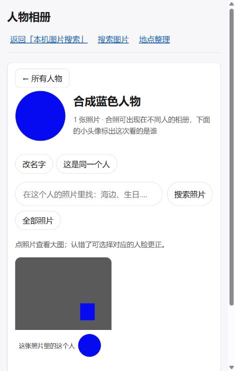
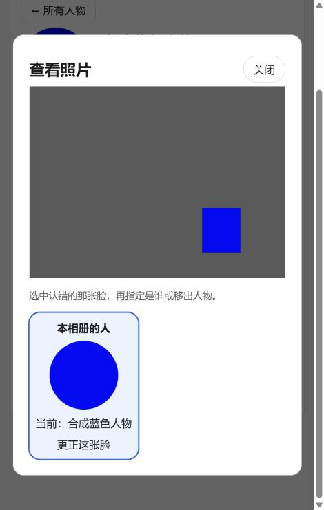

# P4-PERSON-IMAGE-A — 人物相册错图和裁剪偏移修复

2026-10-03；起点3bab1c3；IMPLEMENTED / SCOPED VALIDATION COMPLETE / INDEPENDENT REVIEW PENDING。[补充卡](../tasks/P4-PERSON-IMAGE-A.md)。用户重新授权处理两个照片显示问题；保留个人项目“简单测试”的要求。实现验证阶段未提交或推送；现按用户“简单提交下”补充授权作本地提交，仅纳入本卡产品、测试、截图和交接文件，不推送。本次核查既有JUnit和提交差异，不重复跑测试。

## 结论与根因

整图错图：当前HEAD仍对按asset_id/face_id取图的URL声明一年immutable，尽管重建catalog后数字ID可复用。更改服务端响应头不能使浏览器主动检查已经缓存且仍新鲜的旧响应，因此只改Cache-Control或磁盘缩略图版本不足以让当前页面纠正旧图。新响应统一private,no-cache,must-revalidate；人物页照片、人脸和大图地址加固定新版本参数，并更新静态JS版本以绕开旧响应。底层SHA寻址缩略图/预览继续复用，不删除全库缓存，不重生成全库图片。

圆图偏移：实际face.processor._decode调用load_normalized(long_edge=1280)，JPEG draft在分析前可把4000×3000变为2000×1500。现有检测文档的original_size及bbox实际指向这个正常方向的解码帧，而裁剪之前用完整原图头4000×3000做分母；这会把裁剪中心缩到错误位置。合成反例经真实Pillow draft→analyze_image（仅检测/识别替身）→build_payload/validate_payload→真实ArtifactStore发布→真实API，先前裁剪中心灰色，修复后为目标蓝色。EXIF6旋转情形也通过。

裁剪读取已发布、checksum/byte_size有效、processor/revision/input_revision正确且face_id/bbox与现行记录相符的v1/v2文档，使用文档original_size映射到预览，各轴分别按实际整数尺寸缩放。没有结构文档的旧人工/合成行仍按原图头处理；真实文档丢失/损坏或绑定不符会给已有稳定错误，避免猜测。ArtifactStore文件读取与像素工作在线程池，SQLite查询保持在所属线程。

独立face-crop@2防止复用先前错误的服务器裁剪；旧@1文件仍保留。没有改检测spec、preprocess、face_id、不可变人脸文档/校验和、向量、人物归属或人工知识，**无需重检测、重匹配或重建图文库**。这修复显示帧映射，不改变原检测文档的历史original_size字段语义。

Git核对：954cf00曾尝试改磁盘缩略图版本，3bab1c3已撤回未完成的图片修复；当前仍保留撤销提示10秒自动收起。以本报告和真实HEAD为准，不沿用旧status对已撤回缓存/人脸框的成功描述。

## 简单验证

最终JUnit [p4-person-images.xml](../../test-results/p4-person-images.xml)：**29 tests / 0 failures / 0 errors / 0 skipped**，退出0。

```powershell
.venv/Scripts/python.exe -m pytest -q tests/integration/test_p4_person_image_frames.py tests/integration/test_p3_face_thumbnail.py tests/integration/test_api_files.py tests/integration/test_p4_person_albums.py --basetemp=.pytest-tmp/p4-person-images-old-new --junitxml=test-results/p4-person-images.xml
.venv/Scripts/ruff.exe check src/photo_search/api/routes.py src/photo_search/media/face_crop.py src/photo_search/media/contract.py tests/integration/test_p4_person_image_frames.py tests/integration/test_p3_face_thumbnail.py tests/integration/test_api_files.py
& 'D:/Program Files/nodejs/node.exe' --check src/photo_search/web/persons-albums.js
git diff --check
```

覆盖：大JPEG和旋转照片实际裁剪像素、256px上限、旧错误@1缓存不复用且不删除、faces/向量/不可变产物前后不变、文档checksum/脸框/当前内容绑定拒绝、原单脸裁剪/小脸/旋转/离线/权限/路径保护、HTTP条件请求/HEAD/原图、人物照片分页/头像与邻脸归属。

首次沙箱29例setup因为.pytest-tmp创建WinError5失败，保存p4-person-images-sandbox.xml，按环境失败处理；正常权限路线重跑，未改ACL。实现回归发现SQLite跨线程读取造成9例失败，修为主线程查记录后传普通dict到线程池；随后只剩旧immutable断言未更新，同步为新策略后完整29例通过。未把任何失败运行称为通过。

浏览器验证在隔离的127.0.0.1:8892，夹具位于项目.tmp/p4-person-images-browser/run1，只含一张4000×3000合成JPEG与一个替身检测脸。诊断中模拟原URL返回红色旧图并声明历史一年immutable，先打开预热页面，再进入真正人物页：照片缩略图请求是相同asset_id的新?v=person-media2 URL，实际灰底蓝色区域显示正确；圆头像蓝色；点开大图仍为同一灰底蓝色照片。DOM确认三个相册img及预览img均加载成功。请求证据为无参数旧URL与新参数URL各一次；首次直接导航session JSON被浏览器阻止展示，但正常会话cookie已设置，后续页面/API正常授权。未绕过权限或安全警告。测试服务和标签已关闭。





## 范围与使用

产品改动：api/routes.py，media/contract.py、face_crop.py，web/persons-albums.js、persons.html。新增合成反例test_p4_person_image_frames.py；直接同步两个旧媒体测试的缓存策略和裁剪版本断言。未改其他任务编辑和暂存。

**正常重启应用，然后刷新人物页**即可读取新版JS、响应头和裁剪实现；不用删除catalog、手动清空全部缓存或重新建库。此轮未重启真实8000服务、未打开用户给定照片15/人脸原始内容、未访问真实图库/PhotoSearchData、未加载模型、未执行重检测/重匹配/全量/性能/打包。真实样片效果仍需用户在新版服务上确认；未宣称模型识别精度改善。

独立工程审查仍PENDING，沿用[P4-PERSON-UX-A-review](../tasks/P4-PERSON-UX-A-review.md)，加审检测文档的坐标帧只读投影、校验/绑定/路径拒绝、线程边界和新旧缓存语义。身份/人工知识保持旧约束，不新增模型或性能任务。
