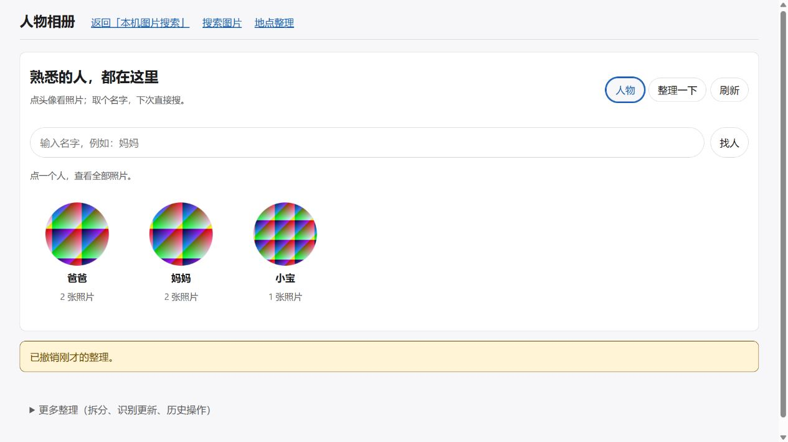

# P4-PERSON-UX-A — 个人使用的人物相册

日期：2026-10-03。状态：IMPLEMENTED / SCOPED VALIDATION COMPLETE；独立工程审查尚未执行，不标正式 PASS。用户两次明确要求个人项目做完后简单测试，本轮限定小样本和直接相关验证，不追加全量、性能或打包任务。

实现基线 fe46753；期间首页和 Qwen 并行提交将 HEAD 推进至 a6cee33。保留其他会话的搜索、首页、临时目录报告与测试编辑。本轮未提交或推送；实际执行模型为当前 Codex 会话，未自动切模型或派生 Agent。

## 用户可见变化

人物页默认展示常用的命名头像，点头像直接进入该人物的全部照片；按名字和已有别名查找，照片按时间翻页，同图多脸只算一张。纯相册浏览读取 SQLite，有界分页，不需要语义模型；相册内的内容搜索复用既有 person_ids 权威范围和搜索会话，超过 5000 候选时显示限制。

“整理一下”集中展示未命名人物，以及已检测但机器未归组、低质量、只有建议和人工移除的脸。取名遇到已有名字会展示明确的并入操作，不再由新页面保存名字直接合并；旧 name API 的自动合并和历史幂等摘要保留。合照先选具体人脸小图再改归属，其他脸不受影响；命名、并入和单脸更正后均可撤销。原批量整理、记录和重检测映射保留在折叠的高级整理中。

新页面采用同源请求及既有会话/CSRF；人物 ID、revision、request_id 和撤销继续使用既有权威用例。只读接口不暴露原图路径、向量、几何或单对相似度。OPEN 重检测映射中的锚点与候选不绕过旧映射审查。



## 漏脸修复与版本边界

已复现并修复长边大于1280时的两个错误：FaceDocument.scale 原先保存逆比例导致 ARTIFACT_INVALID，即使检测无脸也不能保存；bbox/landmarks 原先乘错缩放方向。现在保存正向比例，坐标分别使用实际整数工作尺寸的 x/y 逆变换。检测门限0.5、质量门限和建议/合并门限0.29/0.56保持原值。本轮不能据此宣称真实人物召回率或判断每张合照的漏脸原因。

几何属于 face_id，不能原地改写旧脸。因此使用 spec/preprocess v2、face-document.v2、新 artifact_id 和独立候选世代；v1 ID保持历史算法。实际 ArtifactStore 合成验证了同一输入的新旧不可变产物共存，旧内容未被覆盖。新无脸产物发布后，旧机器未归组事实不再出现在简单入口；仅 redispatch 旧 job 不提前隐藏旧脸。判断依据是不可变已发布产物，不是可变 job.dispatch_spec_revision。

v1 人工归属、锁和排除仍保留；v2 新脸进入 ADR-0010 的 OPEN 映射，不自动接收旧人工关系。此次几何修正不改变用于识别的工作像素、对齐及 ArcFace 权重/归一化/space，因此记录明确的 v1/v2 兼容例外：旧世代继续活动，READY 的 v2 已确认代表可参与后续归类，合并后每个 canonical 人物总上限仍为原代表数限制；不复制全库或激活部分新索引。旧待修复事件按原版本消费，人工操作按每张脸自己的版本预约修复。不同维度、非 READY、未来未知版本不享有该例外。最小决策见 [ADR-0014](../decisions/ADR-0014-person-album-geometry-repair.md)。

新增合成回归曾暴露相同 FP32 单位向量点积略大于1，触发 confidence 的 CHECK 约束；cosine 现夹到数学合法区间[-1,1]，保留全部匹配门限。

## 实际验证

最终 JUnit `test-results/p4-person-ux-a.xml`：**219 tests / 0 failures / 0 errors / 0 skipped**，退出码0。升级测试补充就绪、维度、未来版本隔离和每人上限断言后，直接重跑该文件：`test-results/p4-person-ux-bridge.xml` **3/0/0/0**，属于前述219的子集，不相加。Ruff检查14个直接相关Python文件、两个人物JS的Node语法、git diff --check均通过。

覆盖：名字/别名字面查询与分页绑定；人物照片去重、完整分页与revision失效；新安全命名碰撞零写入、重放及旧接口兼容；显式合并/撤销；合照单脸更正、相邻脸不变、迟到revision拒绝与撤销；自动未归组、人工待归类与重检测hold；横图/竖图/非整数尺寸合法几何；实际不可变产物发布及v1/v2共存；旧人工锚点保持；旧活动世代下新人物在下一张照片继续匹配；发布后未确认崩溃/重放；人工未归类不进入代表。

最终命令（项目Python3.12.10，不安装依赖）：

```powershell
.venv/Scripts/python.exe -m pytest -q tests/integration/test_p4_person_albums.py tests/integration/test_p4_person_face_upgrade.py tests/unit/test_p4_person_face_geometry.py tools/diagnostics/person_face_resize_probe.py tests/unit/test_p3_face_geometry.py tests/unit/test_p3_face_contract.py tests/integration/test_p3_persons_page.py tests/integration/test_p3_face_redetection_hold.py tests/integration/test_p3_face_redetection_upgrade.py tests/unit/test_api_frontend.py tests/unit/test_p3_face_association.py tests/integration/test_p3_face_correction_undo.py tests/integration/test_p3_face_correction_lifecycle.py --basetemp=.pytest-tmp/p4-person-ux-final --junitxml=test-results/p4-person-ux-a.xml
.venv/Scripts/python.exe -m pytest -q tests/integration/test_p4_person_face_upgrade.py --basetemp=.pytest-tmp/p4-person-ux-bridge --junitxml=test-results/p4-person-ux-bridge.xml
```

初次沙箱测试出现临时目录 WinError5（JUnit `test-results/p4-person-ux-a-sandbox.xml`），属环境失败；通过正常权限路线重跑，未修改ACL。实现过程中修复相册多余空终页、静态页导航兼容和浮点confidence问题；旧调查的2个长图失败保留为历史缺陷证据，不作为当前失败。

浏览器使用 `tools/diagnostics/person_album_browser_smoke.py`：隔离项目tmp、6张纯合成图片/6个脸、确定性替身向量，回环8874。实测头像→爸爸2张照片；内容sunset只命中该人物范围；整理入口显示未命名/待归类；命名冲突明确并入且撤销恢复；另取名小宝可搜索；合照选爸爸脸改为妈妈后爸爸2→1，撤销恢复2。截图展示爸爸2、妈妈2、小宝1。最后后台版本兼容补丁仅改后端索引，直接JUnit覆盖；没有冒称再次执行浏览器全流程。临时服务已停止，临时标签已关闭，夹具未清理。

## 改动范围与未验证项

产品：api/queries.py、api/routes.py；face/contract.py、engine.py、index.py、processor.py；persons/albums.py、operations.py、service.py；web/persons.html、persons.css、persons.js、persons-albums.js。新增测试：test_p4_person_albums.py、test_p4_person_face_upgrade.py、test_p4_person_face_geometry.py；新增两个人物诊断工具。并行会话对test_api_frontend.py及search相关文件的改动未纳入本卡实现归属。

未访问真实照片目录、真实PhotoSearchData或大图库夹具；未加载/下载模型，未运行CUDA或真实识别质量测试、全量套件、容量/性能或打包验证。真实库中的历史失败任务没有自动重检，已有人工映射需要旧高级入口确认。原640检测画布对合照小脸的召回限制仍在；本轮未增加检测分辨率、切片或手工画新脸框。

本轮个人功能与指定简单验证已完成。身份版本、权威写入和兼容例外的独立审查仍为 PENDING；下一必要审查入口为 [P4-PERSON-UX-A-review](../tasks/P4-PERSON-UX-A-review.md)，由用户手动选择模型/新会话，不在本实现会话自称完成独立审查。不自动扩展优化工作。

## 2026-10-03个人反馈修复：未命名头像与合照人物辨认

用户报告未命名列表“暂无缩略图”、多个分组打开同一张照片。本轮只检查源码和合成夹具，未访问用户真实图库/PhotoSearchData，也没有调整识别阈值或自动合并人物。

确切根因：face/index.py::_new_person创建name=NULL、avatar_face_id=NULL的人物；新列表此前直接复用person_summary，头像为空时没有从有效成员补选。上一轮浏览器夹具手工填了未命名avatar_face_id，未覆盖真实自动分组的NULL状态。这是实现与验证缺口，本轮补了针对性反例。

albums.py现有独立只读展示头像补选：保留仍属于该人物的既有头像，否则从该人物有效成员选质量/当前版本/尺寸优先的脸。人工移除/活动排除/其他人物的脸不能作为头像。只改响应投影，未写persons.avatar_face_id、operation或revision，旧人员API不变。

每张相册照片加有界person_faces摘要（最多8张有效人脸＋has_more标记，不返回坐标/向量/路径）。页面在相册标题显示当前头像，在照片下显示“这张照片里的这个人”；预览把本相册的人脸排在前面并标记，便于单脸纠正。更新静态资源版本以加载新JS/CSS；图片加载失败与缺少有效人脸有不同提示。

同一合照被不同人物相册包含是有效成员去重规则下的正常结果，不能据相同asset_id自动合并人物。合成反例实测两个没有存储头像的未命名人物共用一张双色照片：响应分别选择左/右face_id，真实受保护缩略图API返回不同红/蓝裁剪，相册person_faces仅含自己；浏览读取前后catalog.iterdump完全相同。人工移除后旧头像不再展示。

简单验证命令与结果：

```powershell
.venv/Scripts/python.exe -m pytest -q tests/integration/test_p4_person_albums.py tests/integration/test_p3_face_thumbnail.py tests/integration/test_p3_persons_page.py --basetemp=.pytest-tmp/p4-person-ux-avatar --junitxml=test-results/p4-person-ux-avatar.xml
```

JUnit **20 tests / 0 failures / 0 errors / 0 skipped**，退出0；Ruff（albums、新用例、浏览器诊断工具）、Node语法、diff-check通过。首次新用例因test helper模块导入路径错误失败，修为integration.test_p3_face_thumbnail后同范围重跑通过；没有复用失败输出作成功证据。

浏览器诊断工具改为生成纯合成红/蓝/绿形状，并给同一合照里的两个未命名人物保留NULL存储头像。确认两者列表头像均加载、分别点开同一照片2显示不同“这个人”裁剪；预览将当前人脸置前标记。首次复用8874地址时浏览器保留了旧合成asset thumbnail，最终用独立8875地址避开跨夹具缓存再验证并保存截图。两个测试服务与标签均已停止/关闭，未动实际应用服务。

证据：[未命名列表](assets/p4-person-ux-avatar-list.jpg)、[蓝色人物相册](assets/p4-person-ux-avatar-album.jpg)、[同图绿色人物相册](assets/p4-person-ux-avatar-other.jpg)。新增改动仍归本卡受影响面，独立审查状态保持PENDING。此次修复头像/身份辨认，不证明真实识别错分已修复；若真实头像是同一人重复分组，需要具体授权样例区分检测重复/特征匹配/历史世代事实，不能用相同整图推断或自动迁移人工知识。源码更新需要正常重启应用再刷新人物页生效，本轮未重启真实服务。

## 2026-10-03本地提交范围

按用户要求提交本会话的人物相册、未命名头像补选、版本化长图几何修复、0.50归人门限和已存特征重匹配，并保留上述定向验证结果；本次只做提交检查，不重复运行测试。用户确认小图错位由其他任务修复，本次不处理，也不纳入该任务的撤销提示、媒体缓存和预览定位框改动。其他任务的编辑及已有暂存状态保留；本地提交，不推送。独立工程审查仍PENDING，下一入口见审查卡。

## 2026-10-03个人反馈修复：撤销提示、旧缩略图与人脸定位框

用户报告命名后的“已保存名字…撤销”提示一直停留、相册缩略图与实际图片错配、参考小图看不出对应哪张脸。本轮没有打开真实数据根，只在诊断脚本生成的三张合成照片中复现验证。

撤销栏此前没有关闭入口且没有生命周期；现在10秒后自动收起，并增加“收起”按钮。操作撤销后仍会立即清除提示。浏览器保存“SZ”后看到撤销栏，等待10秒后AX树确认提示消失。

图片接口URL基于可复用的本地asset_id/face_id，但之前响应声明一年 immutable；替换catalog/复用ID时浏览器可能继续拿旧图。将asset缩略图/预览及人脸裁剪改为 private,no-cache,must-revalidate，利用已有内容ETag重新验证，而不改变内容寻址缓存产物。定向人脸接口回归断言新的Cache-Control策略。浏览器合成合照中照片本身与各自红/蓝人脸裁剪一致。

逐照片受保护人脸响应新增人脸框原坐标；预览用已显示照片的自然尺寸换算到百分比，为所有脸画框，当前人物框为绿色，其余为黄色。API坐标仍只来自权威faces bbox；若缩略图/元数据照片尺寸为空，前端仍以预览图的自然尺寸正确归一。浏览器合成三脸图中目视确认三个框与三张脸对齐，当前人物为绿色。

JUnit `test-results/p4-person-feedback.xml`：**15/0/0/0**。第一次沙箱启动于临时目录创建时WinError5；正常权限路线重跑后一个新断言发现合成asset没有尺寸元数据，修为使用原始框并按预览naturalWidth/Height渲染，再完整重跑通过。Ruff、Node语法、diff-check均通过。未跑全量；没有重扫真实库或加载模型。

## 2026-10-03 INTERNAL_ERROR 后续修正：兼容生产人脸框格式

用户反馈人物相册出现“这次操作没有完成，请重试。（INTERNAL_ERROR）”。定位为上一轮预览框改动的回归：真实人脸处理器将 `bbox_json` 写为 `{"bbox":[x1,y1,x2,y2]}`，而`_face_view()`误把其当作裸数组遍历，`/faces/inbox` 因将键名`bbox`转成浮点数而返回500。现通过既有 `parse_bbox()` 同时读取两种格式；坏几何仅不画框，人脸仍可选择，头像裁剪端点维持原有结构化错误。新增生产格式合成回归。定向JUnit `test-results/p4-person-feedback-bbox.xml` **15/0/0/0**；Ruff/Node/diff-check通过。重启源码服务并用新会话链接后生效。
